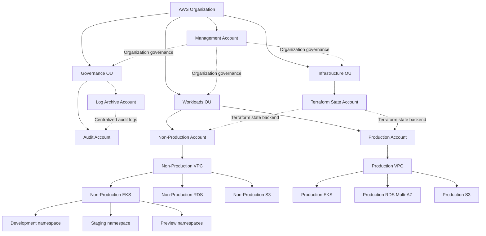
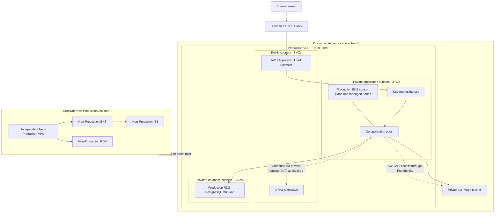
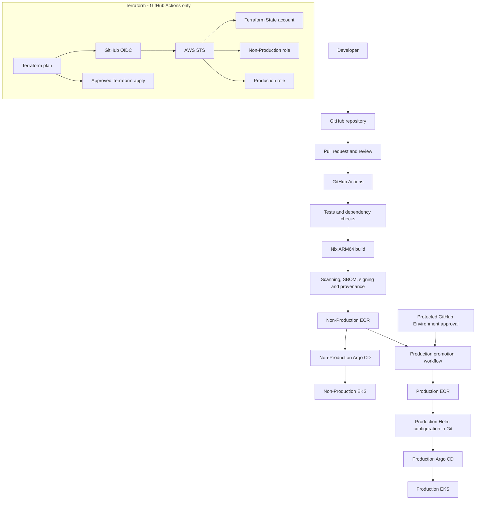
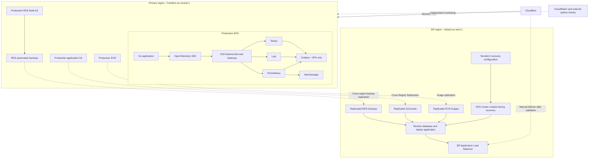

# AWS Cloud Platform Architecture

**Version:** 1.0  
**Status:** Architecture planning baseline  
**Primary region:** Europe (Frankfurt), `eu-central-1`  
**Disaster recovery region:** Europe (Ireland), `eu-west-1`

## 1. Purpose and scope

Design a production-grade, cost-conscious AWS platform for a Go web application serving a frontend, using PostgreSQL for relational data and S3 for image storage.

The platform uses:
- AWS Organizations and Control Tower
- Terraform for infrastructure provisioning
- Amazon EKS for container orchestration
- GitHub Actions for CI and infrastructure automation
- GitHub OIDC for temporary AWS credentials
- Amazon ECR for container images
- Argo CD and Helm for GitOps
- Cloudflare for public DNS and proxying
- Prometheus, Grafana, Loki, Tempo and OpenTelemetry for observability

Application authentication is out of scope for the initial platform.

Primary architectural objective: isolate Production from Non-Production at the AWS account, network, cluster, database and identity levels.

## 2. AWS organization and accounts

Six AWS accounts are planned.

| OU | Account | Responsibility |
|---|---|---|
| Management | Management | Organizations, Control Tower administration, billing and IAM Identity Center |
| Governance | Log Archive | Centralized CloudTrail and AWS Config log storage |
| Governance | Audit | Control Tower audit account |
| Infrastructure | Terraform State | Terraform state backend and associated encryption |
| Workloads | Non-Production | Development, staging and preview workloads |
| Workloads | Production | Production workloads and recovery resources |

Decisions:
- No dedicated Security, Tooling, Network or Backup account initially.
- No GuardDuty or Security Hub initially.
- Production and Non-Production remain separate AWS accounts.
- The Management account contains no application workloads.
- The Log Archive account is reserved for centralized audit logs, not application backups.

## 3. Regional architecture

| Purpose | Region |
|---|---|
| Primary | `eu-central-1` Frankfurt |
| Disaster recovery | `eu-west-1` Ireland |

Regional recovery uses backup-and-restore rather than a continuously running duplicate production environment.

DR resources are initially managed within the existing Production and Terraform State accounts. No separate DR AWS account is planned.

## 4. EKS and compute

Two EKS clusters:

| Cluster | Account | Workloads |
|---|---|---|
| Non-Production | Non-Production | Development, staging and preview namespaces |
| Production | Production | Production application |

Non-Production namespaces:
- `development`
- `staging`
- `preview-pr-<number>`

Namespaces are logical isolation boundaries, not substitutes for AWS account separation.

Initial compute recommendation:

| Cluster | Nodes | Instance type | Aggregate capacity |
|---|---:|---|---|
| Non-Production | 2 | `m7g.large` | 4 vCPU / 16 GiB |
| Production | 3 | `m7g.large` | 6 vCPU / 24 GiB |

Compute decisions:
- Graviton ARM64 instances.
- EKS Managed Node Groups initially.
- One shared node pool per cluster initially.
- HPA for application scaling.
- Karpenter deferred until justified by workload metrics.
- Dedicated system node groups deferred.
- No Fargate initially.
- Production application starts with three replicas distributed across three AZs.
- Use readiness/liveness probes, graceful shutdown, topology spread and a PDB with `minAvailable: 2`.

Node sizes are initial planning values and require load testing, especially because the observability stack shares cluster capacity.

## 5. Networking

Two independent IPv4 VPCs:

| Property | Non-Production | Production |
|---|---|---|
| CIDR | `10.10.0.0/16` | `10.20.0.0/16` |
| AZs | 2 | 3 |
| Public subnets | 2 | 3 |
| Private application subnets | 2 | 3 |
| Isolated DB subnets | 2 | 3 |
| NAT Gateways | 1 | 3 |

Subnet allocation:

**Non-Production**
- Public: `10.10.0.0/20`, `10.10.16.0/20`
- Application: `10.10.32.0/20`, `10.10.48.0/20`
- Database: `10.10.64.0/20`, `10.10.80.0/20`

**Production**
- Public: `10.20.0.0/20`, `10.20.16.0/20`, `10.20.32.0/20`
- Application: `10.20.48.0/20`, `10.20.64.0/20`, `10.20.80.0/20`
- Database: `10.20.96.0/20`, `10.20.112.0/20`, `10.20.128.0/20`

Network decisions:
- No VPC peering or Transit Gateway initially.
- No Network account initially.
- IPv4 only initially.
- EKS nodes and pods do not receive public IPs.
- RDS runs in isolated database subnets.
- VPC CNI with prefix delegation.
- EKS Kubernetes API private endpoint only.
- Human administrative access through VPN.
- S3 Gateway endpoint.
- Interface endpoints selected according to cost and usage.
- Non-Production uses one NAT Gateway, accepting cross-AZ egress dependency.
- Production uses one NAT Gateway per AZ.
- Security groups restrict database access to authorized application workloads.

Public traffic path:

Cloudflare → internet-facing ALB → Kubernetes ingress → Go application.

ACM manages certificates at the ALB. When Cloudflare proxying is enabled, restrict ALB ingress to Cloudflare IP ranges and protect the origin.

## 6. Database and object storage

### PostgreSQL

PostgreSQL is hosted outside Kubernetes using Amazon RDS.

Non-Production:
- One RDS PostgreSQL instance.
- Persistent development database.
- Temporary preview databases.
- No dedicated persistent staging database.
- Unique preview database credentials and cleanup on PR closure, backed by TTL cleanup.

Production:
- Separate RDS PostgreSQL instance.
- Multi-AZ deployment.
- Automated backups and point-in-time recovery.
- Encryption using KMS.
- Private database subnets.
- Deletion protection.
- Secrets Manager.
- Consider RDS Proxy if connection behavior warrants it.

### S3

Separate private buckets per environment for application images and observability storage.

Controls:
- Block Public Access.
- Encryption.
- Versioning where appropriate.
- Lifecycle policies.
- TLS-only access.
- BucketOwnerEnforced ownership.
- Presigned image URLs generated by the Go backend.
- No static AWS access keys.

## 7. CI/CD and GitOps

GitHub Actions is responsible for testing, building, scanning and publishing images.

Argo CD is responsible for reconciling Kubernetes state.

Application flow:

1. Developer opens a pull request.
2. GitHub Actions runs tests, dependency checks and security scans.
3. Nix-based build produces an ARM64 image.
4. Image is pushed to the appropriate ECR repository.
5. Git repository is updated with the image digest and Helm configuration.
6. Argo CD reconciles the desired state.
7. Production promotion requires a protected approval step.

Decisions:
- One Argo CD installation per EKS cluster.
- Helm for application and platform components.
- No direct CI `kubectl` deployment to Production.
- ApplicationSets for preview environment lifecycle.
- Production promotion is explicit.
- Immutable image digests rather than mutable `latest` tags.

### Terraform execution

Terraform runs exclusively through GitHub Actions.

- GitHub OIDC provides temporary AWS credentials through STS.
- No local Terraform execution against AWS.
- No long-lived AWS keys in GitHub Secrets.
- Separate Terraform role from application deployment roles.
- Separate plan and apply permissions.
- Production infrastructure apply requires approval.
- Terraform State account contains the S3 backend.
- Terraform assumes narrowly scoped roles in target accounts.
- Initial OIDC bootstrap is handled through a controlled bootstrap process.

## 8. Observability

Each cluster has its own observability stack.

Components:
- Prometheus for metrics.
- Grafana for dashboards.
- Loki for logs.
- Tempo for traces.
- OpenTelemetry SDK and Collectors.
- Alertmanager.
- kube-state-metrics.
- Node exporter or equivalent OTel host metrics.

Collector topology:
- OTel DaemonSet for node-level collection and container logs.
- OTel Gateway Deployment for application telemetry, cluster metrics and events.
- Go application instrumented using OpenTelemetry.
- Structured JSON logs containing trace identifiers.
- PostgreSQL metrics and connection-pool monitoring.

Storage:
- Prometheus on EBS-backed persistent storage.
- Grafana small persistent volume for state/configuration.
- Loki and Tempo using private S3 buckets.

Initial retention targets:

| Data | Non-Production | Production |
|---|---:|---:|
| Metrics | 7 days | 15 days |
| Logs | 3–7 days | 14 days |
| Traces | 3 days | 7 days |

Initial deployments are deliberately simple and not fully HA. Distributed Loki/Tempo, Kafka and cross-cluster observability are deferred.

Grafana access is VPN-only. It is not publicly exposed through Cloudflare.

CloudWatch remains responsible for AWS infrastructure monitoring and EKS control-plane logs. External HTTP uptime checks complement in-cluster monitoring.

## 9. Security architecture

### Human access
- IAM Identity Center.
- MFA required; phishing-resistant methods preferred.
- Temporary credentials.
- No permanent IAM user access keys for routine work.
- Restricted Production operator role.
- No developer Production access by default.
- Break-glass access with strong MFA and alerting.

### Organization controls
- SCPs for baseline organization guardrails.
- Protect CloudTrail and centralized logs.
- Restrict account departure and unauthorized governance changes.
- Restrict unused Regions where appropriate.

### CI/CD identity
- GitHub Actions OIDC.
- Restrictive trust policies scoped to repository, branch and environment.
- Separate roles for image publishing, deployment and Terraform.
- Protected GitHub Production environment with human approval.

### Kubernetes
- EKS access entries and Kubernetes RBAC.
- Private Kubernetes API endpoint.
- Separate service accounts.
- NetworkPolicies.
- Resource quotas.
- Pod Security Standards Restricted profile where compatible.
- No privileged containers for ordinary workloads.

### Workload identity
Use EKS Pod Identity for application AWS access.

Each application service account receives a dedicated IAM role with narrowly scoped permissions.

The Go application only receives access to its own environment's required S3 resources and other explicitly required AWS services.

### Secrets and encryption
- AWS Secrets Manager.
- External Secrets Operator.
- No secrets in Git or container images.
- KMS encryption for RDS, EBS, S3, Terraform state and backups.
- Separate Production and Non-Production secrets and keys.
- Separate destination-region KMS keys for DR.

### Supply-chain security
- Protected branches and required reviews.
- CODEOWNERS for infrastructure and Production configuration.
- Dependency and secret scanning.
- Container vulnerability scanning.
- SBOM generation.
- Image signing and provenance verification.
- Immutable image digests.
- Promotion of tested artifacts to Production.

### Audit
- Organization CloudTrail.
- AWS Config.
- EKS control-plane audit logs.
- IAM Access Analyzer.
- Centralized audit storage in Log Archive.
- No GuardDuty or Security Hub initially.

## 10. Backup and disaster recovery

Recovery targets are initial planning objectives, not service guarantees.

| Failure scenario | RTO target | RPO target |
|---|---:|---:|
| Pod/node failure | 1–5 minutes | No acknowledged data loss |
| AZ failure | 5–15 minutes | Near-zero committed DB data loss |
| RDS primary failure | 2–5 minutes | Near-zero committed DB data loss |
| Regional failure | 4–8 hours | 30 minutes initially |

Production database:
- RDS Multi-AZ.
- 35-day automated backup retention.
- PITR.
- Cross-region automated backup replication to Ireland.
- Manual snapshots before major upgrades.

S3:
- Versioning.
- Cross-region replication for irreplaceable application data.
- Destination-region KMS key.
- Replication failure monitoring.

ECR:
- Cross-region image replication.

Terraform state:
- S3 versioning.
- SSE-KMS.
- Native S3 lockfiles (`use_lockfile = true`).
- Cross-region replication.
- Controlled DR backend promotion.

EKS:
- Rebuild through Terraform.
- Reinstall platform components and applications through Argo CD.
- No continuously running DR EKS cluster.

DNS:
- Manual Cloudflare failover to the recovered regional ALB.
- Target DNS TTL of 60–120 seconds where supported.
- Failover only after database, storage and application validation.

Backup account:
- Deferred.
- Revisit as a security hardening step.

Testing:
- Monthly database restore test.
- Quarterly DR-region database restore test.
- Quarterly failure/recovery tests.
- Full regional DR exercise every six months.

## 11. Operations and maintenance

Proposed initial policies:
- Review EKS versions quarterly.
- Test Kubernetes and add-on upgrades in Non-Production first.
- Pin Helm chart, provider and module versions.
- Roll nodes rather than modifying them in place.
- Test major PostgreSQL upgrades separately.
- Require rollback or roll-forward plans for Production changes.
- Monitor deployment, database, node and observability capacity.
- Maintain incident and recovery runbooks.

## 12. Deferred capabilities

Not in the initial implementation:
- Karpenter.
- Dedicated system node pools.
- Fargate.
- Service mesh.
- KEDA.
- Multiple ingress controllers.
- Transit Gateway or VPC peering.
- Dedicated Security, Network, Tooling or Backup accounts.
- Distributed observability stack.
- Continuous regional PostgreSQL read replica.
- Automatic regional failover.
- Application-level authentication.

## 13. Open validation items

These are not unresolved architectural choices; they are implementation-readiness checks.

1. Confirm AWS quotas in both regions and all workload accounts.
2. Validate EKS node sizes with application and observability load tests.
3. Recalculate the monthly budget using `m7g.large` and the full observability stack.
4. Validate EKS Pod Identity and NetworkPolicy enforcement.
5. Confirm exact RDS cross-region backup support, replication status and recovery procedure.
6. Test S3 and ECR replication.
7. Define alert ownership, escalation and incident response.
8. Define database migration and rollback procedures.
9. Validate Cloudflare origin protection and regional failover.
10. Complete a Production Operational Readiness Review before launch.

## 14. Architecture principles

1. Production isolation is more important than maximizing infrastructure reuse.
2. Prefer AWS-native managed services over self-hosting critical infrastructure.
3. Keep application workloads stateless wherever possible.
4. Infrastructure changes are reviewed and automated.
5. Terraform is executed only through GitHub Actions OIDC.
6. Git is the source of truth for Kubernetes desired state.
7. Use temporary identities and least privilege.
8. Make recovery procedures repeatable and tested.
9. Avoid premature distributed-system complexity.
10. Measure actual capacity and cost before scaling the platform.

### AWS organization and account structure

### Production and Non-Production runtime architecture

### CI/CD, Terraform and GitOps

### Observability and regional disaster recovery

