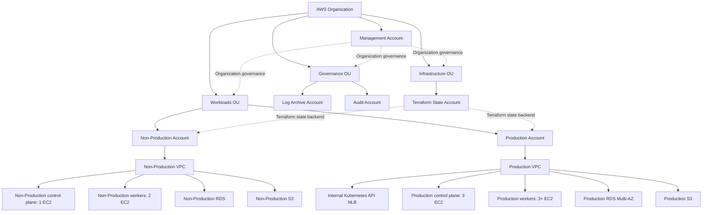
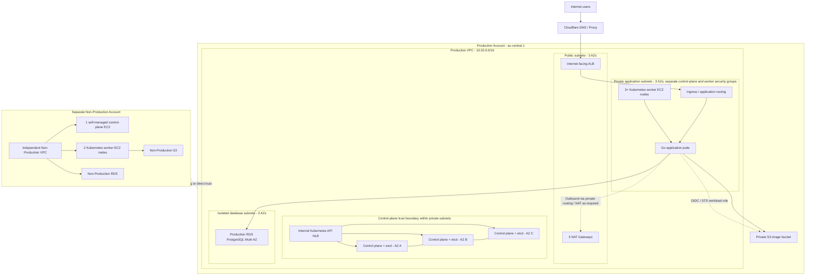
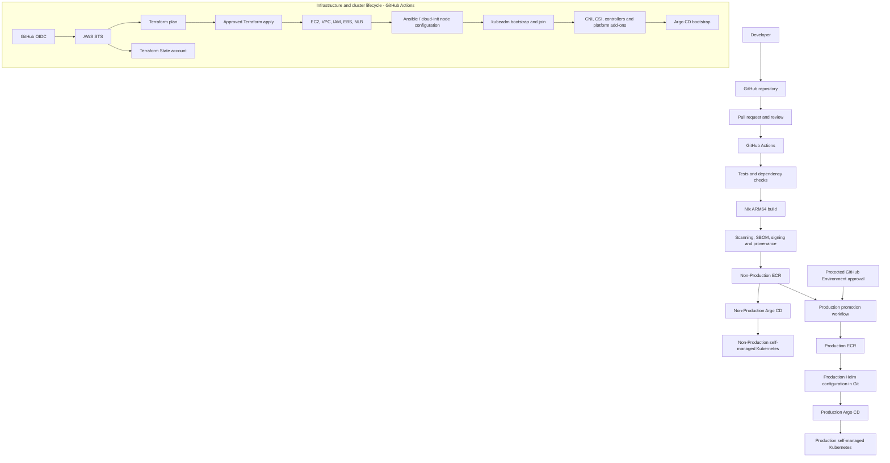
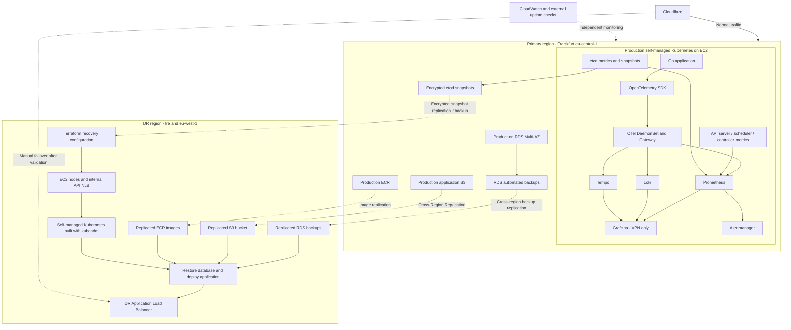
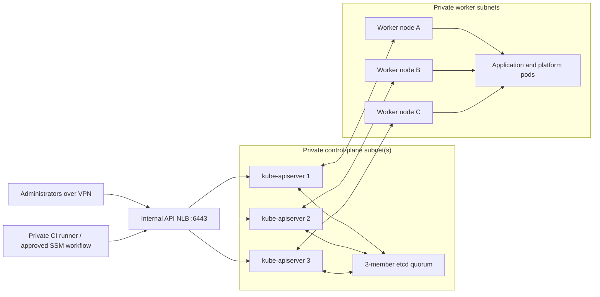

# AWS Cloud Platform Architecture — Self-Managed Kubernetes on EC2

**Version:** 2.0  
**Status:** Architecture planning baseline  
**Primary region:** Europe (Frankfurt), `eu-central-1`  
**Disaster recovery region:** Europe (Ireland), `eu-west-1`

## 1. Purpose and scope

Design a production-grade, cost-conscious AWS platform for a Go web application serving a frontend, using PostgreSQL for relational data and S3 for image storage.

Kubernetes is **self-managed on EC2**. AWS provides compute, networking, storage, load balancing, identity primitives and managed data services; the platform team operates the Kubernetes control plane, etcd, worker nodes, upgrades, certificates, cluster add-ons and recovery.

The platform uses:

- AWS Organizations and Control Tower
- Terraform for AWS infrastructure provisioning
- Self-managed Kubernetes on EC2, bootstrapped with `kubeadm`
- containerd as the container runtime
- GitHub Actions for CI and infrastructure automation
- GitHub OIDC for temporary AWS credentials
- Amazon ECR for container images
- Argo CD and Helm for GitOps
- Cloudflare for public DNS and proxying
- Prometheus, Grafana, Loki, Tempo and OpenTelemetry for observability
- Amazon RDS for PostgreSQL and S3 for object storage

Application authentication is out of scope for the initial platform.

Primary architectural objective: isolate Production from Non-Production at the AWS account, network, cluster, database and identity levels.

### Important operational trade-off

Removing EKS removes the EKS control-plane charge and EKS-specific dependencies, but it does **not** remove the cost or work of running Kubernetes. EC2 control-plane nodes, etcd storage, load balancers, backups, patching, upgrades, certificate rotation, cluster authentication and incident response become platform responsibilities. Budget for engineering and on-call time as well as AWS resources.

## 2. AWS organization and accounts

Six AWS accounts are planned.

| OU | Account | Responsibility |
|---|---|---|
| Management | Management | Organizations, Control Tower administration, billing and IAM Identity Center |
| Governance | Log Archive | Centralized CloudTrail and AWS Config log storage |
| Governance | Audit | Control Tower audit account |
| Infrastructure | Terraform State | Terraform state backend and associated encryption |
| Workloads | Non-Production | Development, staging and preview workloads |
| Workloads | Production | Production workloads and recovery resources |

Decisions:

- No dedicated Security, Tooling, Network or Backup account initially.
- No GuardDuty or Security Hub initially.
- Production and Non-Production remain separate AWS accounts.
- The Management account contains no application workloads.
- The Log Archive account is reserved for centralized audit logs, not application backups.
- Each workload account owns and operates its own Kubernetes cluster and supporting AWS resources.

## 3. Regional architecture

| Purpose | Region |
|---|---|
| Primary | `eu-central-1` Frankfurt |
| Disaster recovery | `eu-west-1` Ireland |

Regional recovery uses backup-and-restore rather than a continuously running duplicate production environment.

DR resources are initially managed within the existing Production and Terraform State accounts. No separate DR AWS account is planned.

The DR cluster is created from version-controlled Terraform and cluster-bootstrap configuration when recovery is required. It is not continuously running.

## 4. Kubernetes and EC2 compute

Two independent self-managed Kubernetes clusters:

| Cluster | Account | Workloads |
|---|---|---|
| Non-Production | Non-Production | Development, staging and preview namespaces |
| Production | Production | Production application |

Non-Production namespaces:

- `development`
- `staging`
- `preview-pr-<number>`

Namespaces are logical isolation boundaries, not substitutes for AWS account separation.

### 4.1 Cluster topology

**Production**

- Three dedicated control-plane EC2 instances, one per Availability Zone.
- Three or more worker EC2 instances, distributed across three Availability Zones.
- Three-member stacked etcd quorum, with one etcd member on each control-plane node.
- An internal Network Load Balancer in front of the Kubernetes API servers on TCP 6443.
- Control-plane and worker nodes use private subnets and have no public IP addresses.
- Control-plane nodes do not run application workloads; use Kubernetes taints to keep ordinary workloads off them.
- Worker nodes are the application and platform workload pool.

**Non-Production**

- One dedicated control-plane EC2 instance for the initial cost-conscious setup.
- Two worker EC2 instances across two Availability Zones.
- Single-member etcd on the control-plane node.
- An internal Network Load Balancer or a private stable API endpoint, depending on the final bootstrap design.
- This is intentionally not control-plane HA: failure of the control-plane instance interrupts Kubernetes API operations until it is recovered. Existing pods may continue running, but scheduling and reconciliation are impaired.
- If Non-Production availability becomes important, move to three control-plane nodes and a three-member etcd quorum.

A single control-plane node is a deliberate Non-Production cost trade-off, not a Production pattern.

### 4.2 Initial EC2 sizing

These are planning values, not validated production sizing.

| Cluster role | Non-Production | Production |
|---|---|---|
| Control plane | 1 × `m7g.large` | 3 × `m7g.large` |
| Workers | 2 × `m7g.large` | 3 × `m7g.large` |
| Initial worker capacity | 4 vCPU / 16 GiB | 6 vCPU / 24 GiB |
| Control-plane capacity | 2 vCPU / 8 GiB | 6 vCPU / 24 GiB |

Use Graviton ARM64 instances and build/publish ARM64 application images. Confirm that every Kubernetes add-on and third-party image supports ARM64 before adoption.

Control-plane nodes need durable, encrypted EBS volumes for the operating system and etcd data. Use separate EBS volumes for etcd where operationally practical; use a supported filesystem and monitor disk latency, free space and fsync performance. Size etcd storage based on measured object volume and retention, not application data volume.

Workers use encrypted EBS root volumes. Application persistent storage uses the EBS CSI Driver.

### 4.3 Kubernetes software baseline

- `kubeadm` for cluster initialization and joining nodes.
- containerd as the CRI-compatible runtime.
- A supported Kubernetes release pinned in configuration.
- Cilium or Calico as the CNI and NetworkPolicy implementation; select one and validate it before production.
- CoreDNS for cluster DNS.
- kube-proxy initially, unless the selected CNI configuration explicitly replaces it.
- AWS EBS CSI Driver for EBS-backed persistent volumes.
- AWS Load Balancer Controller for ALB/NLB integration.
- Metrics Server for resource metrics used by HPA.
- Argo CD for GitOps.
- Helm for application and platform components.

Pin Kubernetes, containerd, CNI, CSI, controller and Helm chart versions. Upgrade one version at a time using a tested runbook.

### 4.4 Cluster bootstrap and node lifecycle

Terraform provisions AWS resources: EC2 instances, IAM roles and instance profiles, security groups, EBS volumes, private API load balancers, target groups, DNS records where required and supporting networking.

Use cloud-init for minimal first-boot preparation and Ansible (or an equivalent controlled configuration tool) for repeatable operating-system and Kubernetes node configuration. `kubeadm` initializes the first control-plane node and joins additional control-plane and worker nodes.

The bootstrap process must be idempotent and version-controlled. Do not store reusable kubeadm join tokens, private keys or certificate material in Git. Deliver short-lived bootstrap material through a controlled secret channel and expire it after node joining.

Node replacement is preferred over in-place repair for failed or drifted nodes. Drain workers before replacement. Control-plane replacement must follow an etcd-aware procedure and preserve quorum.

Terraform manages infrastructure lifecycle; it should not attempt to manage every Kubernetes object. Argo CD manages in-cluster desired state after the cluster is bootstrapped.

### 4.5 Scheduling and scaling

- One shared worker pool per cluster initially.
- HPA for application scaling.
- Cluster Autoscaler may be introduced when node scaling is required; it must be configured for the self-managed EC2/Auto Scaling Group design.
- Karpenter is deferred until justified by workload metrics and operational maturity.
- Dedicated system node groups are deferred; reserve capacity for essential platform components and use taints/tolerations only where needed.
- No Fargate.
- Production application starts with three replicas distributed across three AZs.
- Use readiness/liveness/startup probes as appropriate, graceful shutdown, topology spread constraints and a PDB with `minAvailable: 2`.
- Validate that the worker pool has enough spare capacity to reschedule workloads after one node or AZ is lost.

## 5. Networking

Two independent IPv4 VPCs:

| Property | Non-Production | Production |
|---|---|---|
| CIDR | `10.10.0.0/16` | `10.20.0.0/16` |
| AZs | 2 | 3 |
| Public subnets | 2 | 3 |
| Private application subnets | 2 | 3 |
| Isolated DB subnets | 2 | 3 |
| NAT Gateways | 1 | 3 |

Subnet allocation:

**Non-Production**

- Public: `10.10.0.0/20`, `10.10.16.0/20`
- Application: `10.10.32.0/20`, `10.10.48.0/20`
- Database: `10.10.64.0/20`, `10.10.80.0/20`

**Production**

- Public: `10.20.0.0/20`, `10.20.16.0/20`, `10.20.32.0/20`
- Application: `10.20.48.0/20`, `10.20.64.0/20`, `10.20.80.0/20`
- Database: `10.20.96.0/20`, `10.20.112.0/20`, `10.20.128.0/20`

Network decisions:

- No VPC peering or Transit Gateway initially.
- No Network account initially.
- IPv4 only initially.
- Kubernetes control-plane and worker nodes have no public IPs. Control-plane and worker EC2 instances use the existing private application subnets, with separate security groups and tightly scoped rules; no additional subnet tier is required initially.
- RDS runs in isolated database subnets.
- Kubernetes pod networking is provided by the selected CNI. Choose pod and service CIDRs that do not overlap with VPC, connected networks or each other.
- Kubernetes API endpoint is private and reachable only from approved administrative and cluster networks.
- Human administrative access through VPN or an equivalent private access path.
- S3 Gateway endpoint.
- Interface endpoints selected according to cost and usage (for example, ECR API/Docker, STS, EC2, CloudWatch Logs and Secrets Manager as required).
- Non-Production uses one NAT Gateway, accepting cross-AZ egress dependency.
- Production uses one NAT Gateway per AZ.
- Security groups restrict database access to authorized worker-node/pod egress paths. Where pod-level AWS security groups are not used, enforce the boundary with node security groups plus Kubernetes NetworkPolicies and database authentication.
- Security groups permit Kubernetes control-plane traffic only from the internal API load balancer and approved cluster nodes. Restrict etcd TCP 2379–2380 to control-plane members only.
- Permit required node-to-node, CNI overlay/routing, DNS and health-check traffic according to the chosen CNI and AWS controller documentation; do not use broad all-to-all rules as a shortcut.

Public traffic path:

`Cloudflare → internet-facing ALB → Kubernetes ingress/controller → Go application`

The AWS Load Balancer Controller provisions and manages ALBs from Kubernetes ingress resources (or Gateway resources if that API is adopted). ACM manages certificates at the ALB. When Cloudflare proxying is enabled, restrict ALB ingress to Cloudflare IP ranges, automate updates to those ranges and protect the origin.

Kubernetes API path:

`VPN / approved admin network → internal NLB or private API endpoint → control-plane nodes:6443`

The API endpoint must be stable across control-plane node replacement. Configure API server certificates with the endpoint DNS name in their SANs.

## 6. Database and object storage

### 6.1 PostgreSQL

PostgreSQL is hosted outside Kubernetes using Amazon RDS.

Non-Production:

- One RDS PostgreSQL instance.
- Persistent development database.
- Temporary preview databases.
- No dedicated persistent staging database.
- Unique preview database credentials and cleanup on PR closure, backed by TTL cleanup.

Production:

- Separate RDS PostgreSQL instance.
- Multi-AZ deployment.
- Automated backups and point-in-time recovery.
- Encryption using KMS.
- Private database subnets.
- Deletion protection.
- Secrets Manager.
- Consider RDS Proxy if connection behavior warrants it.

### 6.2 S3

Separate private buckets per environment for application images and observability storage.

Controls:

- Block Public Access.
- Encryption.
- Versioning where appropriate.
- Lifecycle policies.
- TLS-only access.
- BucketOwnerEnforced ownership.
- Presigned image URLs generated by the Go backend.
- No static AWS access keys.

## 7. CI/CD and GitOps

GitHub Actions is responsible for testing, building, scanning and publishing images.

Argo CD is responsible for reconciling Kubernetes state.

Application flow:

1. Developer opens a pull request.
2. GitHub Actions runs tests, dependency checks and security scans.
3. Nix-based build produces an ARM64 image.
4. Image is pushed to the appropriate ECR repository.
5. Git repository is updated with the image digest and Helm configuration.
6. Argo CD reconciles the desired state.
7. Production promotion requires a protected approval step.

Decisions:

- One Argo CD installation per self-managed cluster.
- Helm for application and platform components.
- No direct CI `kubectl` deployment to Production.
- ApplicationSets for preview environment lifecycle.
- Production promotion is explicit.
- Immutable image digests rather than mutable `latest` tags.
- Argo CD bootstrap credentials and cluster registration are handled through a controlled bootstrap process.

### 7.1 Terraform and cluster configuration execution

Terraform runs exclusively through GitHub Actions.

- GitHub OIDC provides temporary AWS credentials through STS.
- No local Terraform execution against AWS.
- No long-lived AWS keys in GitHub Secrets.
- Separate Terraform role from image publishing and cluster deployment identities.
- Separate plan and apply permissions.
- Production infrastructure apply requires approval.
- Terraform State account contains the S3 backend.
- Terraform assumes narrowly scoped roles in target accounts.
- Initial OIDC bootstrap is handled through a controlled bootstrap process.

Terraform provisions EC2, Auto Scaling Groups (if used), load balancers, IAM, security groups, EBS, VPC resources, RDS, S3 and supporting AWS services.

Ansible/cloud-init and version-controlled scripts configure operating systems and install Kubernetes prerequisites. `kubeadm` performs cluster bootstrap and node joining. These steps must be executed by a controlled GitHub Actions workflow or another explicitly approved automation runner with private network access; they must not depend on a developer's laptop.

The workflow should separate:
1. AWS infrastructure plan/apply.
2. Node configuration and cluster bootstrap.
3. Platform add-on installation.
4. Argo CD installation and GitOps handoff.

Use a short-lived, audited access path (for example, a self-hosted GitHub Actions runner in the VPC or an approved SSM-based execution design) for private node configuration. Do not expose SSH or the Kubernetes API publicly for CI convenience.

## 8. Observability

Each cluster has its own observability stack.

Components:

- Prometheus for metrics.
- Grafana for dashboards.
- Loki for logs.
- Tempo for traces.
- OpenTelemetry SDK and Collectors.
- Alertmanager.
- kube-state-metrics.
- Node exporter or equivalent OTel host metrics.
- etcd metrics and health monitoring.
- Kubernetes API server, scheduler and controller-manager metrics.
- EC2, EBS, NLB/ALB and Auto Scaling Group metrics through CloudWatch.

Collector topology:

- OTel DaemonSet for node-level collection and container logs.
- OTel Gateway Deployment for application telemetry, cluster metrics and events.
- Go application instrumented using OpenTelemetry.
- Structured JSON logs containing trace identifiers.
- PostgreSQL metrics and connection-pool monitoring.
- Control-plane components and etcd scraped from private, authenticated endpoints; do not expose these metrics publicly.

Storage:

- Prometheus on EBS-backed persistent storage.
- Grafana small persistent volume for state/configuration.
- Loki and Tempo using private S3 buckets.
- etcd snapshots stored encrypted in S3 with restricted access and retention controls.

Initial retention targets:

| Data | Non-Production | Production |
|---|---:|---:|
| Metrics | 7 days | 15 days |
| Logs | 3–7 days | 14 days |
| Traces | 3 days | 7 days |

Initial deployments are deliberately simple and not fully HA. Distributed Loki/Tempo, Kafka and cross-cluster observability are deferred.

Grafana access is VPN-only. It is not publicly exposed through Cloudflare.

CloudWatch remains responsible for AWS infrastructure monitoring, EC2 status checks, load balancer metrics, EBS and relevant service logs. Kubernetes control-plane logs must be collected from the self-managed nodes (journald/files) and forwarded to the chosen log destination; there are no EKS control-plane logs. External HTTP uptime checks complement in-cluster monitoring.

## 9. Security architecture

### 9.1 Human access

- IAM Identity Center.
- MFA required; phishing-resistant methods preferred.
- Temporary AWS credentials.
- No permanent IAM user access keys for routine work.
- Restricted Production operator role.
- No developer Production access by default.
- Break-glass access with strong MFA and alerting.
- Administrative access to private EC2 instances through SSM Session Manager or VPN; do not expose SSH to the internet.
- Kubernetes API access is private and separately authorized from AWS console/EC2 access.

### 9.2 Organization controls

- SCPs for baseline organization guardrails.
- Protect CloudTrail and centralized logs.
- Restrict account departure and unauthorized governance changes.
- Restrict unused Regions where appropriate.

### 9.3 CI/CD identity

- GitHub Actions OIDC.
- Restrictive trust policies scoped to repository, branch and environment.
- Separate roles for image publishing, infrastructure provisioning and controlled cluster operations.
- Protected GitHub Production environment with human approval.
- Avoid storing long-lived Kubernetes client certificates or cluster-admin kubeconfigs in GitHub Secrets.

### 9.4 Kubernetes authentication and authorization

EKS access entries are not available on a self-managed cluster. Use a documented Kubernetes API authentication design:

- Configure the API server with a trusted OIDC identity provider for human users, or deploy a supported IAM-to-Kubernetes authentication component if AWS IAM role-based access is required.
- Map authenticated identities to Kubernetes groups.
- Use Kubernetes RBAC with least privilege.
- Keep cluster-admin membership small and auditable.
- Use short-lived credentials and a tested break-glass procedure.
- Do not distribute the cluster-admin kubeconfig to developers or CI jobs.
- Restrict API server network access independently of authentication.

Choose and test the authentication approach before production. IAM Identity Center does not automatically become a Kubernetes OIDC issuer; any federation or token exchange required must be explicitly designed.

### 9.5 Workload identity and AWS permissions

EKS Pod Identity and EKS-specific IRSA configuration are not used.

For pod-level AWS permissions, configure a standard Kubernetes OIDC issuer and register its issuer URL as an IAM OIDC identity provider in the workload AWS account. Use projected service-account tokens and AWS STS `AssumeRoleWithWebIdentity` (the generic IRSA pattern) with IAM trust policies restricted to the exact issuer, audience and Kubernetes service-account subject.

Each application service account receives a dedicated IAM role with narrowly scoped permissions.

The Go application only receives access to its own environment's required S3 resources and other explicitly required AWS services.

If the OIDC issuer, discovery document or JWKS hosting is unavailable or incorrectly configured, workload role assumption will fail. Operate and monitor this identity infrastructure as a production dependency. Do not fall back to static AWS keys or a broad node instance profile for application access.

### 9.6 Secrets and encryption

- AWS Secrets Manager.
- External Secrets Operator, configured to use the selected generic workload identity mechanism.
- No secrets in Git or container images.
- KMS encryption for RDS, EBS, S3, Terraform state and backups.
- Separate Production and Non-Production secrets and keys.
- Separate destination-region KMS keys for DR.
- Kubernetes encryption at rest for API data stored in etcd, using a supported API server encryption provider and separately protected encryption keys.
- Encrypt etcd snapshots and restrict restore permissions.

### 9.7 Node and control-plane security

- Harden the EC2 operating system using a documented baseline.
- Patch OS packages and Kubernetes components on a defined schedule.
- Restrict IMDS access; require IMDSv2.
- Use narrowly scoped EC2 instance profiles.
- Restrict control-plane ports, especially etcd, to required peers only.
- Enable API server audit logging and forward logs centrally.
- Protect kubelet endpoints; do not expose unauthenticated read/write kubelet access.
- Use Pod Security Standards Restricted profile where compatible.
- NetworkPolicies enforced by the selected CNI.
- Resource quotas and limits.
- No privileged containers for ordinary workloads.
- Rotate Kubernetes certificates and bootstrap tokens through a tested procedure.

### 9.8 Supply-chain security

- Protected branches and required reviews.
- CODEOWNERS for infrastructure and Production configuration.
- Dependency and secret scanning.
- Container vulnerability scanning.
- SBOM generation.
- Image signing and provenance verification.
- Immutable image digests.
- Promotion of tested artifacts to Production.

### 9.9 Audit

- Organization CloudTrail.
- AWS Config.
- Kubernetes API audit logs from the self-managed API servers.
- IAM Access Analyzer.
- Centralized audit storage in Log Archive.
- OS and control-plane logs forwarded to the central logging destination.
- No GuardDuty or Security Hub initially.

## 10. Backup and disaster recovery

Recovery targets are initial planning objectives, not service guarantees.

| Failure scenario | RTO target | RPO target |
|---|---:|---:|
| Pod/worker-node failure | 1–5 minutes | No acknowledged data loss |
| Control-plane node failure (Production) | 5–15 minutes, subject to quorum and API LB health | No acknowledged application data loss |
| AZ failure | 5–15 minutes | Near-zero committed DB data loss |
| RDS primary failure | 2–5 minutes | Near-zero committed DB data loss |
| Regional failure | 4–8 hours | 30 minutes initially |

Production database:

- RDS Multi-AZ.
- 35-day automated backup retention.
- PITR.
- Cross-region automated backup replication to Ireland.
- Manual snapshots before major upgrades.

S3:

- Versioning.
- Cross-region replication for irreplaceable application data.
- Destination-region KMS key.
- Replication failure monitoring.

ECR:

- Cross-region image replication.

Terraform state:

- S3 versioning.
- SSE-KMS.
- Native S3 lockfiles (`use_lockfile = true`).
- Cross-region replication.
- Controlled DR backend promotion.

Kubernetes and EC2:

- Rebuild EC2 infrastructure through Terraform.
- Reinstall operating-system prerequisites and Kubernetes using the version-controlled configuration and `kubeadm`.
- Restore etcd snapshots only when recovering an existing cluster state; for regional DR, prefer building a clean cluster and reapplying desired state through GitOps unless a specific state-recovery requirement dictates otherwise.
- Reinstall platform components and applications through the bootstrap workflow and Argo CD.
- Back up cluster configuration, PKI material and etcd snapshots securely. Protect encryption keys separately and document restore ordering.
- No continuously running DR Kubernetes cluster.
- Do not treat an EC2 AMI alone as a complete Kubernetes/etcd backup.

DNS:

- Manual Cloudflare failover to the recovered regional ALB.
- Target DNS TTL of 60–120 seconds where supported.
- Failover only after database, storage and application validation.

Backup account:

- Deferred.
- Revisit as a security hardening step.

Testing:

- Monthly database restore test.
- Regular etcd snapshot restore test in an isolated test cluster.
- Quarterly DR-region database restore test.
- Quarterly failure/recovery tests, including control-plane and worker replacement.
- Full regional DR exercise every six months.

## 11. Operations and maintenance

Proposed initial policies:

- Review Kubernetes, CNI, CSI, containerd and add-on versions quarterly.
- Test Kubernetes and add-on upgrades in Non-Production first.
- Pin Helm chart, provider, module and operating-system package versions.
- Roll worker nodes rather than modifying them in place.
- Upgrade control-plane nodes one at a time while preserving etcd quorum.
- Back up etcd before control-plane upgrades and other high-risk changes.
- Monitor etcd quorum, database size, disk latency, API server availability and certificate expiry.
- Test control-plane and etcd recovery procedures regularly.
- Test major PostgreSQL upgrades separately.
- Require rollback or roll-forward plans for Production changes.
- Monitor deployment, database, node and observability capacity.
- Maintain incident and recovery runbooks.
- Maintain an explicit Kubernetes version support and patch policy.
- Track the lifecycle of AMIs and rebuild nodes from approved images.

### Operational ownership introduced by self-managed Kubernetes

The platform team is responsible for:

- Kubernetes control-plane availability and upgrades.
- etcd backup, restore, quorum and disk health.
- API server certificates, CA and PKI protection.
- Kubernetes authentication and RBAC integration.
- CNI, CoreDNS, kube-proxy and CSI lifecycle.
- EC2 node patching, AMI updates and replacement.
- Cluster bootstrap and disaster recovery automation.
- API server audit logs and control-plane monitoring.
- Compatibility testing across Kubernetes, containerd and add-ons.

These responsibilities were largely abstracted by EKS and must be explicitly staffed and tested.

## 12. Deferred capabilities

Not in the initial implementation:

- Karpenter.
- Cluster Autoscaler until node scaling is required.
- Dedicated system worker pools.
- Fargate.
- Service mesh.
- KEDA.
- Multiple ingress controllers.
- Transit Gateway or VPC peering.
- Dedicated Security, Network, Tooling or Backup accounts.
- Distributed observability stack.
- Continuous regional PostgreSQL read replica.
- Automatic regional failover.
- Application-level authentication.
- HA Non-Production control plane.
- Multi-cluster fleet management.
- Automated control-plane replacement beyond tested runbooks.

## 13. Open validation items

These are implementation-readiness checks.

1. Confirm AWS quotas in both regions and all workload accounts.
2. Validate control-plane and worker EC2 sizing with application and observability load tests.
3. Recalculate monthly budget, including control-plane EC2, EBS, internal API NLB, NAT, worker EC2 and operational effort.
4. Select Cilium or Calico and validate pod/service CIDRs, routing, NetworkPolicy and AWS integration.
5. Finalize Kubernetes API authentication and human identity federation.
6. Validate generic Kubernetes OIDC issuer, IAM OIDC provider and `AssumeRoleWithWebIdentity` for workload permissions.
7. Validate AWS Load Balancer Controller on the self-managed cluster.
8. Validate EBS CSI Driver permissions and volume attach/detach behavior.
9. Test kubeadm bootstrap, control-plane join, worker join, node replacement and version upgrades.
10. Test etcd backup, restore, quorum loss and control-plane recovery.
11. Confirm private CI runner or SSM-based cluster bootstrap execution design.
12. Confirm exact RDS cross-region backup support, replication status and recovery procedure.
13. Test S3 and ECR replication.
14. Define alert ownership, escalation and incident response.
15. Define database migration and rollback procedures.
16. Validate Cloudflare origin protection and regional failover.
17. Complete a Production Operational Readiness Review before launch.

## 14. Architecture principles

1. Production isolation is more important than maximizing infrastructure reuse.
2. Prefer AWS-native managed services for critical data services, while accepting explicit ownership of the Kubernetes platform.
3. Keep application workloads stateless wherever possible.
4. Infrastructure and cluster configuration changes are reviewed and automated.
5. Terraform is executed only through GitHub Actions OIDC.
6. Git is the source of truth for Kubernetes desired state.
7. Use temporary identities and least privilege.
8. Make recovery procedures repeatable and tested.
9. Avoid premature distributed-system complexity.
10. Measure actual capacity and cost before scaling the platform.
11. Treat etcd, Kubernetes PKI and the control plane as critical production state.
12. Never expose the Kubernetes API, etcd or administrative node access publicly.

---

# Architecture diagrams

## A. AWS organization and account structure

## B. Production and Non-Production runtime architecture

## C. CI/CD, Terraform, bootstrap and GitOps

## D. Observability and regional disaster recovery

## E. Kubernetes control-plane network and trust boundaries

**Diagram note:** The control-plane nodes and etcd are shown as a dedicated trust boundary. The exact subnet placement, security-group rules, CNI routing and load-balancer target configuration must be validated against the selected Kubernetes and AWS controller versions before implementation.
